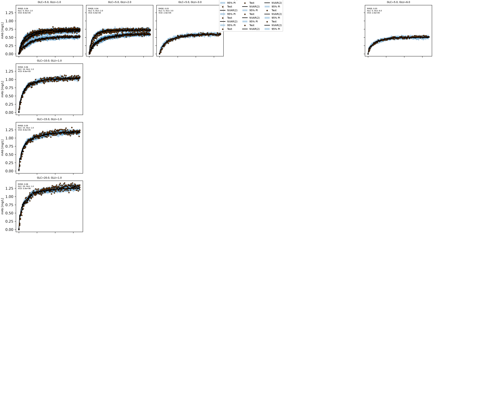

# Optimizing Monoclonal Antibody Production
This program takes several batch runs of a Monoclonal antibody production process with various starting amounts of glucose, glutamine, and viable cell density (VCD) and harvest time in order to maximize the space time profits of the process. This is done by creating a vector autoregression model using KNN to model how different starting conditions affect growth.
## Highlights
- Analyzes how different initial conditions affect growth
- Evaluates different model accuracies in predicting growth
- Optimizes the system to provide best space-time profit
## Environment
- Python 3.14.7
- matplotlib 3.11.0
- numpy 2.5.2
- pandas 3.0.5
- scipy 1.18.0
- sklearn 1.9.0
## Code Design
### Data Loading
Before the model can be trained on the dataset it needs to be loaded into the main file. To account for the fact the batch files are not all listed in sequential order, it takes each file in the datasets folder of the form “batch_(batch number).csv”. From that list the code extracts the batch ID number and adds it to the batch_ids list. Additionally, the initial conditions for every batch provided is extracted into a data frame so they can be found later when constructing the model.
### Feature Engineering
Since this project seeks to optimize the profit of the system, the feature that must be plotted is the mAb concentration as it is the sole part of the process that generates money. 

### Model Training
The program initially compares two different models, polynomial regression and uniform distance K nearest neighbors, on their ability to predict the mAb concentrations based on the initial conditions of glucose and glutamine concentrations, as well as the VCD.  For each the vector autoregression model is run using lagged values from 1 and 2, with the values kept low to prevent model overfitting and ensure they capture the true values. Each model creates a pipeline using a StandardScalerVAR class object with the lagged values p as the input. For each model a three-fold cross validation is performed so the data can be compared on how it predicts unseen data. The model is then fit and the initial conditions for the specific batch are extracted. 
To estimate the level of uncertainty in the predictions, 20 forecast simulations are run for each p value in each model type. This section creates a white noise figure that allows the true value for the to be within the plotted area with 95% confidence. The program then checks if the data for given initial conditions is in the dataset and if it is it is sent to the corresponding model parameter’s sublot. The scoring value for model, root mean squared error (RMSE) is then used to compare model’s effectiveness and exported to a table.

### Optimization
After selection of a preferred model based on which gave a lower RMSE and tighter confidence intervals the code creates another pipeline for model creation that has the same parameters as the best model. For the optimization process, the program only looks at the values for initial conditions within the range of its training data as it cannot accurately predict interactions beyond those values. Additionally, for the retrieval time, the bounds are set hours between the start time and a time value well within the stagnation point of mAb production. The program then uses a helper function called simulate to find values for and calculate_economics to determine a predicted value for mAb and the negative space-time profit of the system. This value is then minimized with its output being returned as the optimized initial conditions. As in the model training section, a 95% confidence interval is created for the different economic values.
## Analysis

### Batch Selection
An important part of the modelling process is the selection of different batches to train the model on. While using a number of batches greater than the 30 could create a more accurate model of how the three initial conditions affect the mAb production, doing so with a large number of runs is extremely cost inefficient, as collecting data for each run requires the necessary inputs and operation time to collect the data. As such, the process was limited to only 30 batches. The batches that were used in creating the model were selected by keeping several variables constant, ensuring that the model saw how certain parameters independently affect the mAb production, as well as using somewhere multiple variables were different to see how the different parameters interact with each other and how those interactions affect production and the time to reach the stagnation point, the point where the amount of mAb in the system is staying relatively constant. Reaching the stagnation point earlier is considered better as the cell culture value is independent of harvest time after reaching that point while the space-time profit decreases as time goes on.
### Model Architecture 
A time series forecasting model was selected as the three initial conditions that are being used in optimization are change over time and the data is equally spaced with respect to time, making an autoregressive model a particularly attractive option. Since there are multiple data initial conditions (glucose, glutamine and VCD) a nonlinear autoregression model like vector autoregression must be used to forecast the data points.
For the vector autoregression model, the selected model type was a K nearest neighbors regression with 3 nearest neighbors and p value of 2 was selected, running 20 simulations. In the K nearest neighbors model uniform weighting was decided as the datasets contained visible noise for mAb concentrations and distance weighting could lead to overfitting the noise of the system. For the model selection a polynomial regression model was also considered as a possible model and p values of 1 and 2 were used for each model type. For the polynomial model it used a degree of 2. The reason for the low number for nearest neighbors and polynomial degrees investigated was to ensure there’s no overfitting of the model, ensuring the model is modelling the actual trends of the inputs, rather than just modelling the trends of the data it was trained on, allowing for more accurate predictions of the unseen data.
The number of simulations that were run on the datasets was kept relatively low as a computing limitation as while larger numbers of simulations would reasonably lead to better modelling, larger numbers of simulations require much more computing power, resulting in the process running inefficiently. The value can be increased by the user assuming they have . 
By performing a 3-fold cross validation on each model, they can be scored on their RMSE allowing for comparison on model performance. As summarized in table 1, the value of RMSE was found to be lowest in the K nearest neighbors model with a p value of 2, with an RMSE on the mAb concentration of 0.0435 mg/L.

Table 1: Summary of effectiveness of different model types.

|Model                                                                                                                                                                                     |p                                                                                                                   |N simulations                                                                                                                                                                                                                                                                                                                                                                                                                                                                                                                                                                  |RMSE (mean) [[mg/L]]                                            |RMSE (SD) [[mg/L]]                                                  |
|------------------------------------------------------------------------------------------------------------------------------------------------------------------------------------------|--------------------------------------------------------------------------------------------------------------------|-------------------------------------------------------------------------------------------------------------------------------------------------------------------------------------------------------------------------------------------------------------------------------------------------------------------------------------------------------------------------------------------------------------------------------------------------------------------------------------------------------------------------------------------------------------------------------|----------------------------------------------------------------|--------------------------------------------------------------------|
|poly                                                                                                                                                                                      |1                                                                                                                   |20                                                                                                                                                                                                                                                                                                                                                                                                                                                                                                                                                                             |0.08308879694673836                                             |0.04514088940296988                                                 |
|poly                                                                                                                                                                                      |2                                                                                                                   |20                                                                                                                                                                                                                                                                                                                                                                                                                                                                                                                                                                             |0.08757734150920839                                             |0.0824851172303134                                                  |
|knn                                                                                                                                                                                       |1                                                                                                                   |20                                                                                                                                                                                                                                                                                                                                                                                                                                                                                                                                                                             |0.044943146956618926                                            |0.024627314290719574                                                |
|knn                                                                                                                                                                                       |2                                                                                                                   |20                                                                                                                                                                                                                                                                                                                                                                                                                                                                                                                                                                             |0.04353327684798423                                             |0.02315465656411796                                                 |

### Selection of Initial Conditions And Harvesting Time

Observing the graphs created to visualize the model allows for the investigation of how certain initial conditions affect mAb production. At lower concentrations of glutamine the produced mAb is higher than while higher concentrations yield a lower amount of mAb. A possible reason for this is because of the lower amounts of ammonia and lactate found after the stagnation point in batches that had lower glutamine levels. A such, the optimized conditions minimize the value of initial glutamine as it leads to a higher cost of the culture and lower production of mAb.
From the same figures, it was observed that at higher concentrations of glucose in the system, the production of mAb increased. This aligns with what is expected, as glucose acts as a nutrient for the cells and is therefore used by the cells to produce mAb. However, glucose adds to the cost of the system, therefore optimization was based around finding a balance between increasing mAb by adding glucose and not increasing it so high that the process becomes unprofitable. From this, an initial glucose concentration of 17.46 mM was found to be most profitable.
Higher values of VCD were found to increase the amount of mAb produced. Since the VCD represents the number of viable cells in the medium, higher values of VCD result in higher production of mAb as there are more viable cells capable of producing the desired product. From this, it was determined that the highest value of VCD tested was responsible for producing the largest space-time profits. The values decided on for optimal space time profits was 8.0E5 cells/mL Much like the glucose concentration, it can be expected that larger VCD values could produce diminishing returns.
From beyond a certain point, the concentration of mAb begins to stagnate, harvesting beyond this point is uneconomical and therefore inefficient. Since higher process times result in lower space time profits, the culture harvest must occur when this point is reached to maximize the process’ profits. The ideal time determined by the optimization algorithm was found to be at 199.2 hours after the process begins, translating to 8.31 days after inoculation.

From beyond a certain point, the concentration of mAb begins to stagnate, harvesting beyond this point is uneconomical and therefore inefficient. Since higher process times result in lower space time profits, the culture harvest must occur when this point is reached to maximize the process’ profits. The ideal time determined by the optimization algorithm was found to be at 199.2 hours after the process begins, translating to 8.30 days after inoculation.

### Final Result
From the prescribed initial conditions and the harvesting time it was found that cost of the cell culture would be $594.57/L. These initial culture conditions produce an mAb concentration of 1.35767mg/L with a monetary value of $1357.67/L with a 95% confidence interval of [$1316.67, $1413.33]. Taking the cost, culture value, day of downtime and required number of days before harvest, the value for the space-time profit of the system was determined to be $81.94/(L *d) with a 95% confidence interval of [$77.64, $88.04].
The estimated space-time yield of the system was found to be 0.15mg/(L*d) with a 95% confidence interval of [0.14mg, 0.15mg].

